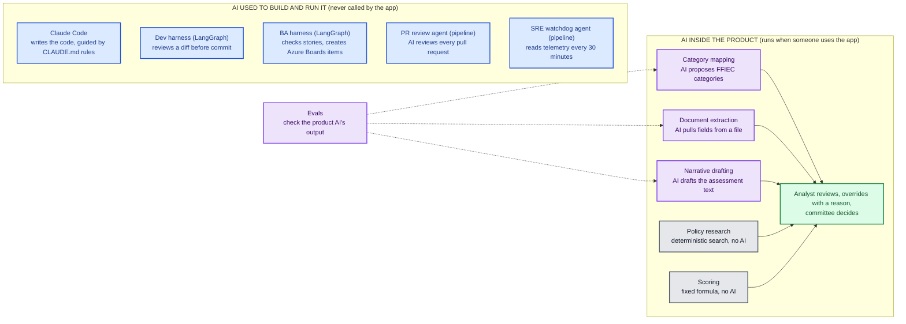
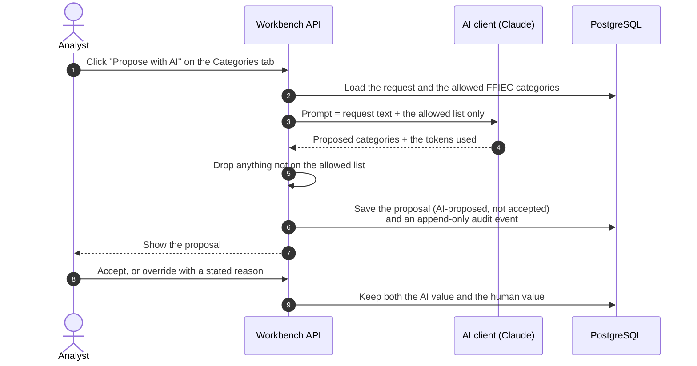
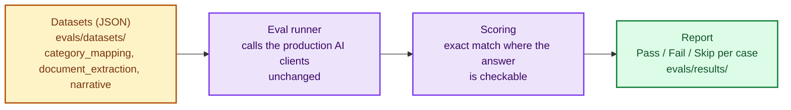
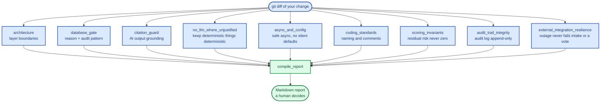
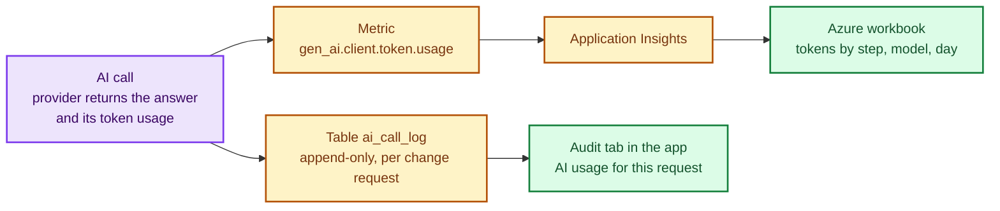

# AI in the Workbench, and Judging Q&A — Briefing

A companion to [`presentation-tech-architecture-overview.md`](presentation-tech-architecture-overview.md)
(the application's architecture and flow) and its [script](presentation-tech-architecture-script.md).
Those explain **what the product does**. This explains the part the judges' guidance keeps asking
about: **where AI is used, how we know its output is good, how we measure what it costs, and what
AI we used to build the thing** — plus short answers to the likely questions.

Read in this order if you have five minutes: section 1 (the one picture), section 3 (evals),
section 7 (the answers).

---

## 1. Two different kinds of AI — keep them apart

The single most useful distinction. Judges will mix them up unless we do not.

| | Inside the product | Used to build and run it |
|---|---|---|
| **When it runs** | When a user clicks a button in the app | During development and in the pipelines |
| **What it is** | Three Claude calls, behind one abstraction | Claude Code, two LangGraph CLIs, two pipeline agents |
| **How we know it is good** | **Evals** (section 3), guardrails in code, human review | The harness rules and the pipeline gates |
| **Who decides** | A human, always | A human merges every PR |

**The rule behind all of it: the system prepares, humans decide.** No AI output is ever an
approval, a rejection or a score.

---

## 2. What the AI does behind each screen

One change request, in the order an analyst works it:

| Screen / tab | AI? | What happens | The guardrail |
|---|---|---|---|
| **Categories** | Yes | Proposes which of the four FFIEC categories apply (Products & Services, Customers & Entities, Geographic Locations, Delivery Channels) | The model is only given the allowed categories; any category not on that list is discarded |
| **Policy** | **No** | Finds relevant policy text with Postgres full-text search | Deterministic: a keyword search needs no model, so we did not spend one |
| **Extraction** | Yes | Pulls structured fields out of an uploaded PDF, Word or Excel file | Every field carries a confidence score and the **source excerpt** it came from; anything unsure is forced to "needs review" |
| **Narrative** | Yes | Drafts the assessment text from the mapped categories, the relied-upon policy and the extracted facts | It may only cite what it was given; anything it cannot support goes in a separate `unsupportedClaims` list, never into the text |
| **Scoring** | **No** | Residual = Inherent − (Control effectiveness × Mitigation) | A fixed formula, with a hard guarantee that residual risk can never reach zero |
| **Finalize / Committee** | **No** | Humans vote and decide | Nothing is auto-approved or auto-rejected |

A note on the category rules: the FFIEC framework is what grounds **category mapping**. Extraction
and narrative drafting have their own guardrails (above), but they are not "scored against FFIEC
rules" — the narrative draws on the categories that category mapping already produced.

Every human edit or override requires a reason, and **both** the AI's original and the human's
version are kept. The audit trail is append-only at the database level (a trigger refuses any
`UPDATE` or `DELETE`), not just by application permission.

---

## 3. Evals — how we know the AI output is good

**The one-line version:** evals are to the AI steps what unit tests are to code. A fixed set of
scenarios with known right answers is run through the *same production AI code*, and the output is
scored automatically.

**A worked example** (category mapping, case `cm-01`): the input is a clear wire-transfer product
change. The expected answer is the Products & Services category, and the allowed list for a
product change is Products & Services plus Customers & Entities. The runner asks the real AI
client, then checks two things: the expected category is among those proposed (a plausible
extra from the allowed list is fine), and **nothing outside the allowed list** was proposed.
Both true = Pass; a missing expected category or an off-list one = Fail.

| Suite | Cases | How it scores |
|---|---|---|
| Category mapping | 5 | The expected FFIEC category codes must all be proposed (extras from the allowed list are fine), and nothing off-list |
| Document extraction | 4 | Exact or substring match on field values; ambiguous text **must** be flagged for review, clear text must not |
| Narrative drafting | 3 | A **proxy only**: citation keywords present, well-formed, feedback visibly changes a regeneration |

- **Why deterministic scoring:** categories and field values are checkable facts, so a second model
  grading the first would add noise, not rigour.
- **The honest limit (say it before they ask):** narrative *quality* cannot be verified by keyword
  matching. The guard against invented claims is the prompt contract (`unsupportedClaims`) plus the
  analyst's review gate, not the eval. Our README says so plainly.
- **Two cases never call the model** (an unmapped change type, an empty document). They test the
  app's own guard clauses and must pass with no AI configured.
- **Run it:** `dotnet run --project evals/Humaid.RiskGovernance.AdminUI.Evals`. Without an API key the
  AI cases report *Skip*, not *Fail*.

Details: [`evals/README.md`](../../evals/README.md).

---

## 4. The development-side AI, and where LangGraph is (and is not)

### The dev harness — in one sentence
> Before you commit, a LangGraph review reads your diff and checks it against our own rules —
> architecture layering, the database pattern, citation guarding, deterministic-versus-AI judgement,
> async and config safety, coding standards, and three project-specific rules (residual risk never
> reaches zero, the audit trail stays append-only, a Mock Systems failure never fails intake or a
> vote) — and prints a report; a human decides what to do. In CI the same report is posted on the
> pull request.

- **Why nine nodes instead of one big prompt:** each check is narrow, sees only the diff and one rule
  area, and runs independently. That is more reliable than one prompt asked to check everything.
  The rules live in prompt files, so tuning one needs no code change.
- **The three project-specific checks only run when relevant files change** (a path match on the
  diff), so most pull requests do not pay for them.
- **In CI it is advice, not a gate:** the report is posted on the PR, and the pipeline goes red only
  if a check could not run, never because of a finding.
- **Nothing is auto-fixed or auto-committed.**

### Everything else on the build side
| Piece | What it does |
|---|---|
| **Claude Code + `CLAUDE.md`** | We gave Claude the framework, the language, the structure and the rules, and directed it. The repo's commit history is the evidence. |
| **BA harness** (LangGraph) | Checks epics and stories against our standards and creates the work items directly in Azure Boards |
| **PR review agent** (pipeline) | AI reviews every pull request; only a *blocking* finding fails the build, and an AI outage never blocks a PR |
| **SRE watchdog agent** (pipeline) | Every 30 minutes reads Application Insights, writes a plain-language verdict, and opens, updates or closes a GitHub issue |

### Where LangGraph is — the accurate answer
- **Used for development tooling:** the dev harness and the BA harness are LangGraph graphs.
- **Not in the product's runtime.** The deployed app's AI steps run on our C# clients. We evaluated
  adopting LangGraph in the product and documented why we recommend against it for this submission
  ([`langgraph-evaluation.md`](langgraph-evaluation.md)).
- **A scoped demonstrator exists:** `ai/langgraph/` has a working, tested LangGraph version of
  category mapping behind the same interface; it is not wired into the deployed app
  ([`langgraph-integration.md`](langgraph-integration.md)).

---

## 5. Measured token use

**What we record:** for every successful AI call, the exact input and output tokens the provider
reports (plus cache tokens for Anthropic), tagged with the step that made the call, the provider and
the model. Nothing is estimated locally. A failed call records nothing, and a count the provider
did not report is stored as empty, never as zero.

- **Fleet view (all requests):** the metric lands in Application Insights; the Azure workbook charts
  it by step, model and type.
- **Per-request view:** the Audit tab of an assessment shows each AI call and the totals for that
  request. Analysts and Admins only.
- **Not recorded:** a cost in currency (rates differ by model and contract).

> **Status caveat — check before presenting.** The token capture, the per-request table and the
> workbook are built and tested, but they only show real numbers once the pull requests are merged
> and deployed. Before claiming "we measure tokens", run **Propose with AI** once and confirm the
> request's Audit tab shows an AI usage row. If it has not been deployed, say "calls, latency and
> failures are monitored today; token capture is built and is the next deploy".

---

## 6. Proof for every stage of the development life cycle

| Stage | How AI was applied | Evidence in the repo |
|---|---|---|
| **1. Requirements** | AI research to fill the gaps in the brief; BA harness checks and creates the stories | `docs/requirements/user-stories.md` (20 epics, 81 stories with Given/When/Then), `ai/research/`, `harness/ba_harness/` |
| **2. Design** | Architecture, data model and diagrams drafted with Claude and reviewed | `docs/architecture/` (C4, ecosystem, DB schema, architecture mapping) |
| **3. Development** | Claude Code directed by `CLAUDE.md`; the dev harness reviews each diff | `CLAUDE.md`, `harness/dev_harness/`, the commit history |
| **4. Testing** | About 150 automated unit tests; QA test-case standards; evals for the AI steps | `tests/`, `harness/test_case_harness/`, `evals/`, `docs/qa/` |
| **5. Deployment** | Terraform modules and Azure DevOps pipelines; image build, Trivy scan, deploy to Container Apps; an AI review gate on every PR | `ops/iac/`, `.azure-pipelines/` |
| **6. Operations** | Application Insights, metric alerts, the SRE watchdog agent, the AI monitoring workbook | `ops/iac/environments/dev/main.monitor.tf`, `.azure-pipelines/observability/` |

---

## 7. Likely questions — answers to say in 30 to 45 seconds

Each answer is about 100 words. Lead with the first sentence; the rest is there if they keep
asking.

**How do you know the AI's output is good?**
> We treat the AI steps like code: they have tests. Our evals run fixed scenarios with known right
> answers through the same production AI code and score the result automatically — category mapping
> and extraction by exact match, because those are checkable facts. Narrative quality isn't something
> you can verify by matching keywords, and we say so; for that, the guard is the prompt contract —
> it may only cite what it was given — plus the analyst's review gate. Nothing the AI produces
> reaches a committee without a human having reviewed it.

**Do you measure token use?**
> Yes. For every AI call we record the exact tokens the provider reports — input, output and cache —
> tagged by step and model. Fleet-wide that goes to Application Insights and an Azure workbook;
> per request, it's stored in an append-only table and shown on the assessment's Audit tab, so we
> can say what one assessment cost. And we kept tokens down by design: policy search and scoring
> are deterministic, so only three steps call a model at all.
> *(Only say this once it is deployed — see the caveat in section 5.)*

**Why aren't policy search and scoring AI?**
> Because they don't need it. Ranking indexed text by relevance is a solved search problem, and
> scoring is a fixed formula with a hard guarantee that residual risk can never reach zero. A model
> there would add cost, latency and non-determinism, and weaken a guarantee a regulator wants to see.
> We used AI only where judgement over free text is the actual job: proposing categories, pulling
> fields from documents, and drafting the narrative.

**How do you keep a human in control?**
> The system prepares, humans decide. Every AI output is stored as a proposal, never an outcome.
> A human can override anything but must state a reason, and we keep both the AI's version and
> theirs. The audit trail is append-only in the database itself — a trigger refuses updates and
> deletes — and access is role-based and enforced at the API, not just hidden in the UI. Nothing is
> auto-approved or auto-rejected anywhere.

**How do you stop it inventing things?**
> By grounding every call. Category mapping only sees the allowed categories, and anything off that
> list is discarded. Extraction must return the source excerpt for each field, and anything unsure is
> forced to "needs review". The narrative may only cite what it was given, and what it can't support
> goes in a separate list instead of the text. Then the analyst reviews it. Our evals check the
> first two automatically.

**Where does LangGraph fit?**
> Our development harnesses are LangGraph graphs: one reviews a developer's diff against our rules
> with nine narrow checks running in parallel, and one validates stories and creates them in Azure
> Boards. The product's own AI steps run on C# clients — we evaluated putting LangGraph in the
> product and documented why we advise against it for this scope. We also built a working LangGraph
> version of category mapping as a demonstrator, not wired in.

**What AI did you use to build this?**
> Claude Code, directed rather than prompted blindly: we gave it the stack, the structure and our
> rules in a `CLAUDE.md`, and our commit history shows the work incrementally. On top of that, the
> dev harness reviews each diff before commit, an AI agent reviews every pull request in the pipeline
> — only a blocking finding fails the build — and an SRE watchdog agent reads our telemetry every
> thirty minutes. Humans merge everything.

**How do you monitor it in production?**
> The app and the Mock API send requests, dependencies and errors to Application Insights. Native
> alerts email the team on a burst of failures or unhandled exceptions, and an anomaly detector looks
> for unusual failure patterns. On top of that, a watchdog agent runs every thirty minutes, turns the
> numbers into a plain-language verdict, and keeps one GitHub issue per condition. There's a
> workbook for AI call volume, failures, latency and tokens.

---

## 8. Do not claim

- **Token numbers or a "measured token use" demo** until the capture is deployed and you have seen a
  row (section 5).
- **An eval pass rate**, unless you have just run the evals and can show the report. We have a
  methodology and datasets, not a published results table.
- **"LLM judge" or "AI grades the AI".** Our evals score deterministically; narrative uses a proxy.
- **LangGraph in the product.** It is in the development harnesses and a demonstrator.
- **Extraction or narrative being "scored against FFIEC rules".** Category mapping is; the others have
  their own guardrails (section 2).
- **Scale or load numbers.** Dev is deliberately small and cost-conscious (Consumption plan, no HA).
